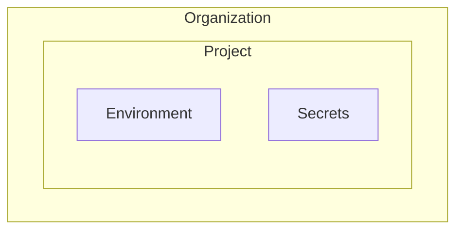

# Secret Sharing Planning Docs

This doc will guide through how sharing secrets from sharer to recepient works.

## Definitions

1. **Sharer :** The person who shares a secret with others.
2. **Recepient :** The person who receives access to a shared secret.
3. **Scope :** Access levels for sharing secrets ex. (Global, Org, Project, Env, Secret)
4. **Inviation :** A request created by sharer to recepient containing sharing access information

## Features

1. Share secrets
2. Assign Roles and Permissions
3. Authorize users Permission for action
4. Modify users Permissions
5. Sync changes
6. Revoke access

## Working

### Sharer Steps

- Sharer select the scope of the Access
- Add the Recepients
- Add roles and permissions
- send invitation to recepients

### Recepient Steps

- Recepient will receive the Invitation
- Review the Inviation
- Take Decision (Accept, Reject)
- Access the secrets

## Concepts

- **Scope :** Main Aim to set a scope is to give permissions inside the scope only and deny access outside the scope



## Sharer Steps Low Level Design

Sharer Send Request from frontend client to backend server endpoint for sharing resources to recipients with scope, role, permissions/

### endpoint

/v1/api/share/invitation

### request payload

```typescript
SendShareInvitation {
  sharerId: string;
  recipientEmails: string[];
  orgId: string;
  projectId: string[];
  secretId: string[];
  role: string;
  expireAt: Date
}
```

### Validations

- Authorize sharer has permission and access to share the resource
- Validated org id, projectIds, environment in the project and SecretId

### Get Data

Get names for every object Ids like org, projects, envs, secrets to send info in user email. perfrom this while validation because we are going to look in db to validate ids

### Create DB document entry

after authorize create a entry in shareInvitation db collection model

```Typescript
export interface ICreateSendShareInvitation {
  sharerId: Types.ObjectId;
  recipientEmails: string[];
  orgId: Types.ObjectId;
  projectId: Types.ObjectId[];
  secretId: Types.ObjectId[];
  role: string;
  expireAt: Date;
}
```

### Send Invitation

For each recipient send email showing all the details about request and gave them option for accept or reject the invitation

- send email in parallel in promisses so required less time

## Recipients Steps Low Level Design

- Check the invitation in mail with information
- option for Accept or Reject
